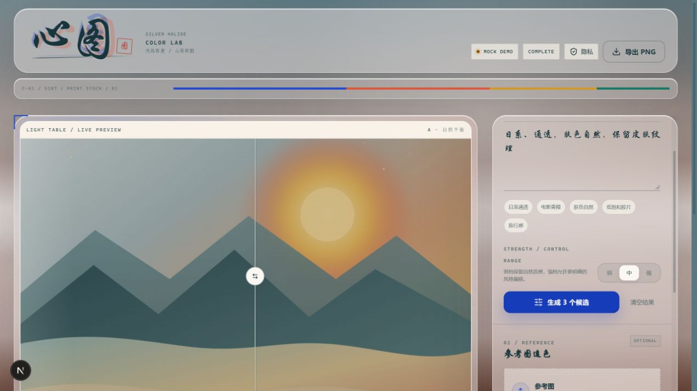
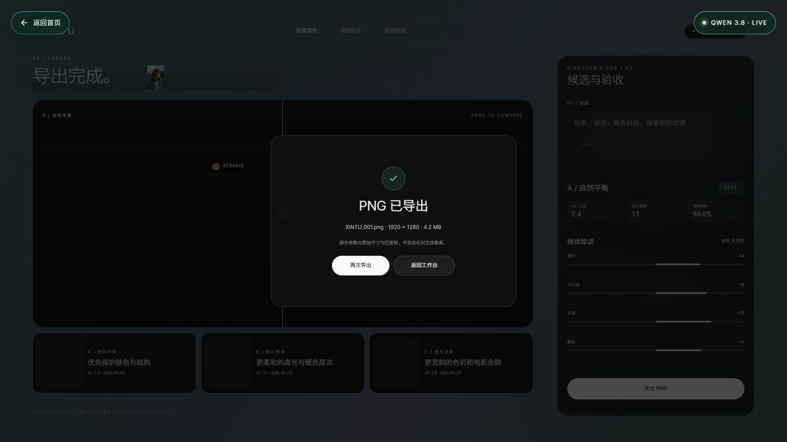

# 心图 / Silver Halide Color Lab

一个有界的 Agentic Color Grading Workflow：AI 负责理解画面、动态规划调色步骤、生成可解释参数，Canvas 在本地完成确定性渲染。

**不生成新像素，不改变画面内容，不无限自主循环。**



## 在线体验

- **公开 Mock Demo**：[https://xintu-demo.vercel.app](https://xintu-demo.vercel.app)
- 公开 Demo 固定使用本地 Mock Planner，不配置大模型 Key，不消耗任何模型额度。
- 可以完整体验：上传照片、选择调色方向、生成 3 个候选、拖动前后对比、查看评估指标、导出 PNG。
- 真实 Qwen 3.8 视觉分析版本采用私有部署，避免公开调用消耗 API 额度。


真实 Qwen 3.8 视觉分析与 PNG 导出效果（私有部署）：



### 别人如何了解这个项目

1. 打开公开 Mock Demo，直接体验完整产品交互。
2. 查看 README 中的界面截图、三候选与前后对比效果。
3. 阅读下方架构与 Agent 边界，了解它为什么不是普通滤镜。
4. 如需真实模型版本，克隆源码后自行部署，并配置自己的千问 API Key。

## 产品定位

心图面向人像与旅行照片的轻度创作者。用户上传一张照片，用自然语言描述想要的氛围，系统会：

1. 分析画面与用户意图
2. 动态选择调色工具和顺序
3. 生成结构化调色参数
4. 在浏览器本地确定性渲染候选
5. 评估肤色、天空、结构与参考相似度
6. 未通过时最多修正 2 轮
7. 输出 3 个候选，支持手动微调与 PNG 导出

## 视觉方向

Silver Halide Color Lab：

- 暖银灯箱与电影后期工作台
- 骨白纸面、雾蓝灰与暖银灰
- 钴蓝、朱红、藏红花黄与翡翠绿作为高级撞色
- 不使用大面积黑色背景
- 渐变只作为状态、指标与品牌光谱的签名元素

## 功能

- 目标图片上传与自动降采样
- 参考图上传
- 自然语言调色描述
- 弱 / 中 / 强三档强度
- 动态调色规划
- Mock Provider 与可选 Qwen 3.8 Flash Provider
- Canvas 本地确定性调色
- 前后拖动对比
- 3 个候选方案
- Agent Trace：PLAN → APPLY → EVALUATE → REFINE
- 指标面板：ΔE Lab、肤色偏移、天空偏移、结构保持、剪切比例、修正轮次
- 13 项手动参数微调
- PNG 导出
- 响应式桌面 / 移动端
- 键盘焦点、减少动效与基础无障碍支持

## 快速开始

要求 Node.js 20.9 或更高版本。

```bash
npm install
npm run dev
```

打开 http://localhost:3000。

没有 API Key 时，应用会自动使用 Mock Provider。可以直接点击「载入演示照片」，再点击「生成 3 个候选」。

## 环境变量

复制 `.env.example` 为 `.env.local`：

```bash
cp .env.example .env.local
```

默认 Mock 模式：

```env
AI_PROVIDER=mock
```

启用 Qwen 3.8 Flash（阿里云 DashScope 直连）：

```env
AI_PROVIDER=openai
OPENAI_API_KEY=your-dashscope-api-key
OPENAI_BASE_URL=https://dashscope.aliyuncs.com/compatible-mode/v1
OPENAI_MODEL=qwen3.8-flash
AI_TIMEOUT_MS=45000
MAX_IMAGE_MB=15
```

`OPENAI_MODEL` 必须与阿里云百炼控制台中开通的模型 ID 保持一致。Provider 必须支持视觉输入，并能返回严格 JSON。凭据只在服务端读取，不会进入客户端代码。

Vercel AI Gateway OIDC 路径仍保留为可选方案；只有在 `OPENAI_BASE_URL` 指向 `https://ai-gateway.vercel.sh/v1` 时才会使用 `VERCEL_OIDC_TOKEN`，不会误用于 DashScope。

## 脚本

```bash
npm run dev        # 启动开发服务器
npm run build      # 生产构建
npm run start      # 启动生产服务器
npm run lint       # ESLint
npm run typecheck  # TypeScript 类型检查
npm test           # Vitest 单元测试
```

## 架构

```text
app/
  page.tsx
  api/agent/analyze/route.ts
  api/agent/refine/route.ts

components/studio/
  studio-shell.tsx
  before-after.tsx
  prompt-panel.tsx
  upload-dropzone.tsx
  agent-trace.tsx
  candidate-rail.tsx
  evaluation-panel.tsx
  parameter-panel.tsx
  plan-card.tsx
  use-studio.ts

lib/color/
  schema.ts
  engine.ts
  metrics.ts
  types.ts

lib/agent/
  candidates.ts
  schema.ts
  types.ts

lib/ai/
  provider.ts
  mock-provider.ts
  openai-compatible.ts
  prompt.ts

lib/image/
  browser.ts
```

### Agent 边界

- 只做调色规划与参数修正
- 不生成像素
- 不改变画面内容
- 不自动发布
- 不持久化用户图片
- 最多选择 4 个工具
- 最多修正 2 轮
- 参数必须经过 Zod schema 校验与范围裁剪
- 超过时间或成本限制时停止

### 技术栈

- Next.js 16 App Router
- React 19
- TypeScript
- Tailwind CSS 4
- Canvas 2D
- Zod
- Vitest
- Lucide React

## 指标说明

当前版本使用轻量浏览器端指标：

- `ΔE Lab`：CIE76 色差近似，不是完整 ΔE2000
- 肤色偏移：基于肤色启发式蒙版的平均 RGB 偏移
- 天空偏移：基于蓝色主导区域的启发式蒙版
- 结构保持：原始图与结果图的灰度相关性
- 剪切比例：接近纯黑或纯白通道的采样比例

这些指标用于演示有界评估闭环，不替代专业色彩科学或人工审片。

## 安全与隐私

- 图片不会被持久化。
- Mock 模式完全在浏览器中处理。
- AI 模式下，图片会发送给配置的模型 Provider 进行分析。
- 渲染与导出始终在浏览器本地完成。
- 不在日志中记录图片、Prompt 或完整模型响应。
- 请求体大小限制为 `MAX_IMAGE_MB`。
- Provider 超时后自动回退到 Mock 模式，并在 UI 中显示当前 Provider 状态。

## 已知限制

- 当前不包含登录、支付、订单、云端历史或批量处理。
- 当前不是微信小程序。
- 真实照片的质量需要在人像、夜景、逆光、天空等场景中继续校准。
- 实时 Provider 返回格式依赖所选模型，必须支持视觉输入与 JSON 输出。
- 当前结构指标是相关性近似，不是完整 SSIM 实现。

## GitHub 发布检查

```bash
npm ci
npm run lint
npm run typecheck
npm test
npm run build
```

CI 配置位于 `.github/workflows/ci.yml`。

## 设计文档

实现规格位于：

```text
docs/superpowers/specs/2026-11-02-agentic-color-workflow-design.md
```

## License

MIT
