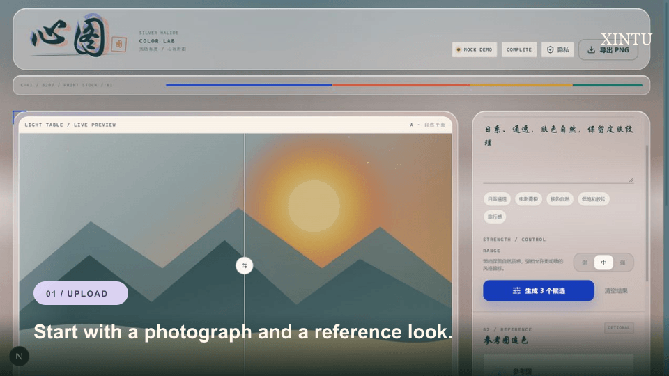
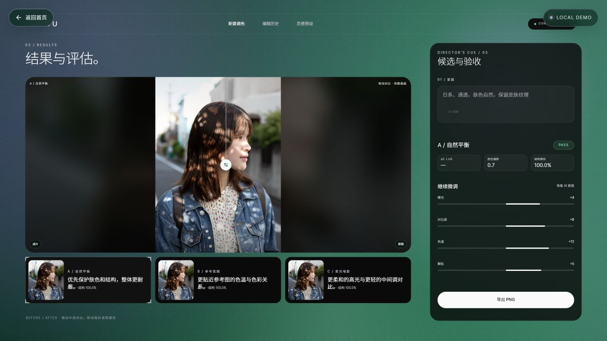
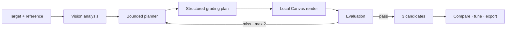

# XINTU

### Reference-based AI color grading that never generates pixels.

[English](README.md) · [简体中文](README.zh-CN.md) · [Recruiter portfolio](https://airzhou1zz.github.io/XINTU/portfolio/)

[](https://github.com/AirZhou1zz/XINTU/actions/workflows/ci.yml)
[](LICENSE)
[](https://nextjs.org/)
[](https://www.typescriptlang.org/)



**XINTU is a bounded image-agent experiment for reference-based color grading.** The model interprets the image and the requested look, plans a small set of grading operations, and emits structured parameters. The original pixels are rendered locally with Canvas 2D. It does not generate a new scene, replace the sky, or alter a person's identity.

<p>
  <a href="https://airzhou1zz.github.io/XINTU/portfolio/"><strong>AI PM portfolio</strong></a>
  ·
  <a href="https://xintu-demo.vercel.app"><strong>Try the free demo</strong></a>
  ·
  <a href="docs/live-qwen-export.png">See real Qwen output</a>
  ·
  <a href="#how-it-works">Read the workflow</a>
</p>

> The public demo is deliberately deterministic and uses a local mock planner. It costs nothing to try and makes no model API calls. Real Qwen 3.8 output is shown in the screenshots below.

## Recruiter portfolio

A mobile-first case study is available at [airzhou1zz.github.io/XINTU/portfolio/](https://airzhou1zz.github.io/XINTU/portfolio/). The print-ready QR card is available at [docs/resume-qr-card.png](docs/resume-qr-card.png).

## Why XINTU?

Most AI photo editors change the image by generating new content. XINTU explores a narrower and more controllable problem:

- Match a reference look without regenerating the photograph.
- Keep faces, objects, geometry, and scene content intact.
- Turn model output into explainable, bounded grading parameters.
- Evaluate the result and retry at most twice.
- Render the same input and parameters to the same output in the browser.
- Run a complete product demo without requiring an API key.

This makes the project useful as both a small photo-editing product and a reference implementation for **bounded visual agents**.

## What it does

1. Upload a target photo and an optional reference image.
2. Describe the desired mood in natural language. XINTU detects portrait, landscape, ocean, mountain, night, or city scenes and chooses three relevant directions even when the prompt is vague.
3. Let the bounded agent choose grading tools and order them.
4. Generate structured color parameters.
5. Render three scene-aware candidates locally with Canvas 2D.
6. Evaluate skin, sky, structure, clipping, and color distance.
7. Refine up to two rounds when the result misses its target.
8. Compare, fine-tune 13 parameters, ask for optional visual review, record a subjective score, continue with natural-language feedback, and export a PNG.



## Demo modes

| Mode | Model | API cost | Purpose |
| --- | --- | --- | --- |
| Public demo | Local mock planner | Zero | Anyone can explore the full interaction |
| Local live mode | Qwen 3.8 Flash via DashScope | Your own key | Real image analysis and planning |
| Deterministic render | Browser Canvas | Zero | Inspectable and repeatable output |

The public demo intentionally does not expose the owner's API key or bill the owner's account.

## How it works



The model never draws the final image. It only returns a validated plan. Rendering and export stay inside the browser.

## Agent boundaries

- Plans grading operations instead of generating pixels.
- Selects no more than four tools.
- Returns parameters validated by Zod and clamped to safe ranges.
- Refines no more than two times.
- Stops on timeout or provider failure.
- Falls back to the deterministic mock provider when live analysis is unavailable.
- Does not persist uploaded images.
- Does not automatically publish or share results.

## Evaluation signals

The current prototype reports lightweight browser-side signals:

- `ΔE2000`: CIEDE2000 color difference against the optional reference image.
- Skin-tone shift: heuristic skin mask and average RGB offset.
- Sky shift: blue-dominant region heuristic.
- Structure retention: grayscale correlation between source and result.
- Clipping ratio: sampled pixels near black or white.
- Refinement count: bounded retries before the workflow stops.

These are product-demo metrics, not a substitute for professional color science or human review.

## Quick start

Requirements: Node.js 20.9 or newer.

```bash
npm install
npm run dev
```

Open [http://localhost:3000](http://localhost:3000). With no API key, XINTU runs in deterministic mock mode. Click **Load demo photo**, then generate the three candidates.

## Live model setup

Copy the example environment file:

```bash
cp .env.example .env.local
```

Configure Qwen 3.8 Flash through the DashScope OpenAI-compatible endpoint:

```env
AI_PROVIDER=openai
OPENAI_API_KEY=your-dashscope-api-key
OPENAI_BASE_URL=https://dashscope.aliyuncs.com/compatible-mode/v1
OPENAI_MODEL=qwen3.8-flash
AI_TIMEOUT_MS=45000
MAX_IMAGE_MB=15
```

The provider must support image input and return valid JSON. Credentials are read only on the server and are never included in client code.

## Architecture

```text
app/
  api/agent/analyze/route.ts
  api/agent/refine/route.ts

components/studio/
  studio-shell.tsx
  before-after.tsx
  candidate-rail.tsx
  evaluation-panel.tsx
  parameter-panel.tsx
  use-studio.ts

lib/
  agent/      planner and candidate generation
  ai/         provider adapters and prompt contract
  color/      schema, Canvas engine and metrics
  image/      browser image loading and downscaling
```

## Quality checks

```bash
npm ci
npm run lint
npm run typecheck
npm test
npm run build
```

The repository includes 25 unit tests across five test files and a GitHub Actions CI workflow.

## Security and privacy

- Uploaded images are not persisted by XINTU.
- Mock mode processes everything locally.
- Live mode sends the image to the configured model provider for analysis.
- Rendering and export always happen in the browser.
- API keys and image payloads are never logged.
- Request size is limited by `MAX_IMAGE_MB`.
- Provider timeout triggers a visible fallback to local mock mode.
- Never commit `.env.local`, provider keys, or deployment tokens.

Please report vulnerabilities privately through GitHub Security Advisories. See [SECURITY.md](SECURITY.md).

## Current limitations

- No login, payments, cloud history, or batch processing yet.
- Not a WeChat Mini Program.
- The browser metrics are intentionally lightweight approximations.
- Real-model output quality still needs calibration across portraits, backlight, night scenes, and skies.
- Model compatibility depends on vision input and strict JSON support.

## Roadmap

- Cached real-model sample replays that require no API key.
- More before/after scenes and documented failure cases.
- Batch presets and reusable grading profiles.
- Stronger color metrics and reproducible benchmark fixtures.
- English and Chinese product documentation improvements.

## Contributing

Product feedback, real-world photo cases, and focused pull requests are welcome. Please read [CONTRIBUTING.md](CONTRIBUTING.md) before opening an issue or PR.

If XINTU is useful to your work, a star helps other builders discover the project.

## License

[MIT](LICENSE)