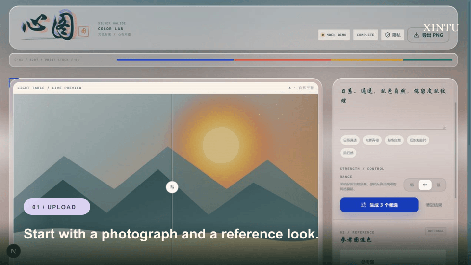
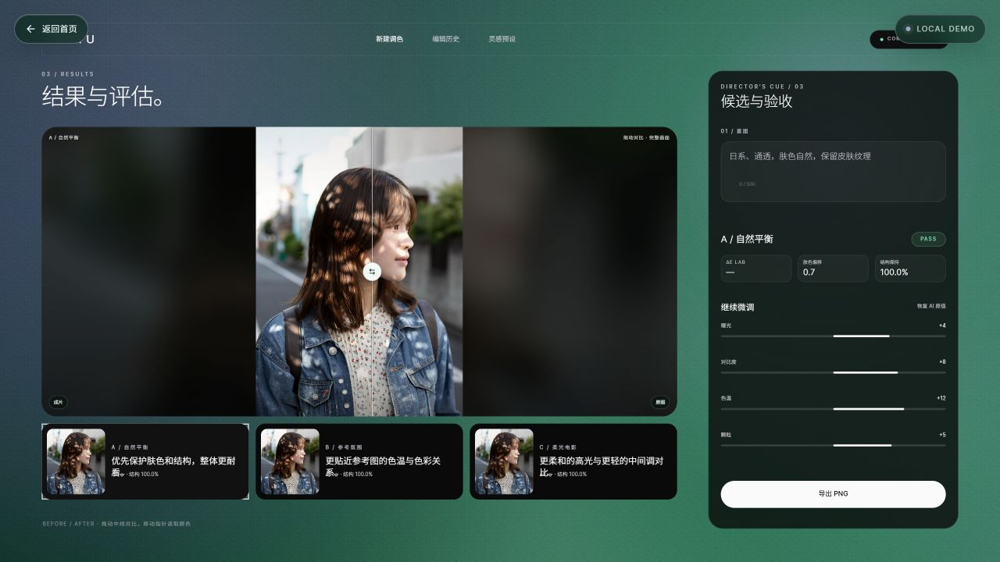
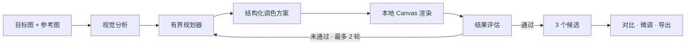

# XINTU

### 基于参考图的 AI 调色 Agent，不生成任何新像素。

[English](README.md) · [简体中文](README.zh-CN.md) · [招聘作品集](https://xintu-demo.vercel.app/portfolio)

[](https://github.com/AirZhou1zz/XINTU/actions/workflows/ci.yml)
[](LICENSE)
[](https://nextjs.org/)
[](https://www.typescriptlang.org/)



**XINTU 是一个有边界的图像 Agent 实验：AI 理解画面与参考意图，规划少量调色工具并输出结构化参数；最终由浏览器中的 Canvas 2D 对原始像素进行确定性渲染。** 它不生成新场景、不替换天空、不改变人物身份。

<p>
  <a href="https://xintu-demo.vercel.app/portfolio"><strong>AI 产品经理作品集</strong></a>
  ·
  <a href="https://xintu-demo.vercel.app"><strong>免费体验公开 Demo</strong></a>
  ·
  <a href="docs/live-qwen-export.png">查看真实千问效果</a>
  ·
  <a href="#工作方式">了解工作流</a>
</p>

> 公开 Demo 使用本地 Mock Planner，不调用付费模型、不产生 API 费用。真实 Qwen 3.8 的效果截图见下方。

## 招聘作品集

移动端优先的项目案例页：[xintu-demo.vercel.app/portfolio](https://xintu-demo.vercel.app/portfolio)。适合直接放进简历的二维码卡片：[docs/resume-qr-card.png](docs/resume-qr-card.png)。

## 为什么做 XINTU？

大多数 AI 修图工具通过生成新内容来修改照片。XINTU 选择了一条更窄、更可控的路径：

- 参考一张图的色调，不重新生成照片。
- 保留人物、物体、几何结构和画面内容。
- 把模型输出变成可解释、受约束的调色参数。
- 对结果进行评估，最多修正两轮。
- 相同图片与参数得到可重复的本地渲染结果。
- 没有 API Key 也能体验完整产品流程。

它既是一个小型修图产品，也是一个关于**有界视觉 Agent** 的参考实现。

## 产品流程

1. 上传目标照片和可选参考图。
2. 用自然语言描述想要的氛围。
3. Agent 选择调色工具并动态规划顺序。
4. 生成结构化调色参数。
5. Canvas 在本地渲染三个候选。
6. 评估肤色、天空、结构保持、剪切和色差。
7. 未达到目标时最多修正两轮。
8. 拖动对比、手动微调并导出 PNG。



## Demo 模式

| 模式 | 模型 | API 费用 | 用途 |
| --- | --- | --- | --- |
| 公开 Demo | 本地 Mock Planner | 零 | 任何人都能完整体验交互 |
| 本地真实模式 | Qwen 3.8 Flash via DashScope | 使用自己的 Key | 真实图像理解与规划 |
| 确定性渲染 | 浏览器 Canvas | 零 | 可检查、可重复的输出 |

公开 Demo 不会暴露项目所有者的 API Key，也不会消耗项目所有者的模型额度。

## 工作方式



模型不直接绘制最终图片，只返回经过校验的调色计划。渲染和导出全部在浏览器内完成。

## Agent 边界

- 只规划调色操作，不生成像素。
- 最多选择 4 个工具。
- 参数由 Zod 校验，并被限制在安全范围内。
- 最多修正 2 轮。
- 超时或 Provider 失败时停止。
- 实时分析不可用时自动回退到确定性 Mock。
- 不持久化用户上传的图片。
- 不自动发布或分享结果。

## 评估指标

当前版本使用轻量浏览器端指标：

- `ΔE Lab`：CIE76 近似，不是完整 ΔE2000。
- 肤色偏移：基于肤色启发式蒙版的平均 RGB 偏移。
- 天空偏移：基于蓝色主导区域的启发式蒙版。
- 结构保持：原图与结果图的灰度相关性。
- 剪切比例：接近纯黑或纯白通道的采样比例。
- 修正轮次：有界重试次数。

这些指标用于演示评估闭环，不替代专业色彩科学或人工审片。

## 快速开始

要求 Node.js 20.9 或更高版本。

```bash
npm install
npm run dev
```

打开 [http://localhost:3000](http://localhost:3000)。没有 API Key 时会自动使用 Mock 模式。点击「载入演示照片」，再生成 3 个候选即可体验完整流程。

## 接入千问

复制环境变量文件：

```bash
cp .env.example .env.local
```

通过 DashScope OpenAI-compatible 接口接入 Qwen 3.8 Flash：

```env
AI_PROVIDER=openai
OPENAI_API_KEY=your-dashscope-api-key
OPENAI_BASE_URL=https://dashscope.aliyuncs.com/compatible-mode/v1
OPENAI_MODEL=qwen3.8-flash
AI_TIMEOUT_MS=45000
MAX_IMAGE_MB=15
```

模型必须支持视觉输入并返回合法 JSON。凭据只在服务端读取，不会进入客户端代码。

## 架构

```text
app/
  api/agent/analyze/route.ts
  api/agent/refine/route.ts

components/studio/
  studio-shell.tsx
  before-after.tsx
  candidate-rail.tsx
  evaluation-panel.tsx
  parameter-panel.tsx
  use-studio.ts

lib/
  agent/      planner and candidate generation
  ai/         provider adapters and prompt contract
  color/      schema, Canvas engine and metrics
  image/      browser image loading and downscaling
```

## 质量检查

```bash
npm ci
npm run lint
npm run typecheck
npm test
npm run build
```

仓库包含 5 个测试文件、21 项单元测试，以及 GitHub Actions CI 工作流。

## 安全与隐私

- XINTU 不持久化上传的图片。
- Mock 模式完全在浏览器中处理。
- 真实模式会把图片发送给配置的模型 Provider 进行分析。
- 渲染和导出始终在浏览器本地完成。
- 不在日志中记录 API Key、图片内容或完整模型响应。
- 请求体大小受 `MAX_IMAGE_MB` 限制。
- Provider 超时后会明确回退到本地 Mock 模式。
- 永远不要提交 `.env.local`、API Key 或部署 Token。

安全问题请通过 GitHub Security Advisories 私下报告，详见 [SECURITY.md](SECURITY.md)。

## 当前限制

- 暂无登录、支付、云端历史或批量处理。
- 当前不是微信小程序。
- 浏览器端指标是有意保持轻量的近似实现。
- 真实模型在人像、逆光、夜景和天空场景下仍需继续校准。
- Provider 必须支持视觉输入和严格 JSON 输出。

## 路线图

- 增加无需 API Key 的真实模型样例回放。
- 补充更多前后对比和公开失败案例。
- 支持批量预设与可复用调色方案。
- 强化色彩指标和可复现基准样例。
- 持续完善中英文产品文档。

## 参与贡献

欢迎提交产品反馈、真实照片场景和范围明确的 Pull Request。提交 Issue 或 PR 前请阅读 [CONTRIBUTING.md](CONTRIBUTING.md)。

如果这个项目对你的工作有帮助，欢迎点一个 Star，帮助更多构建者发现它。

## License

[MIT](LICENSE)